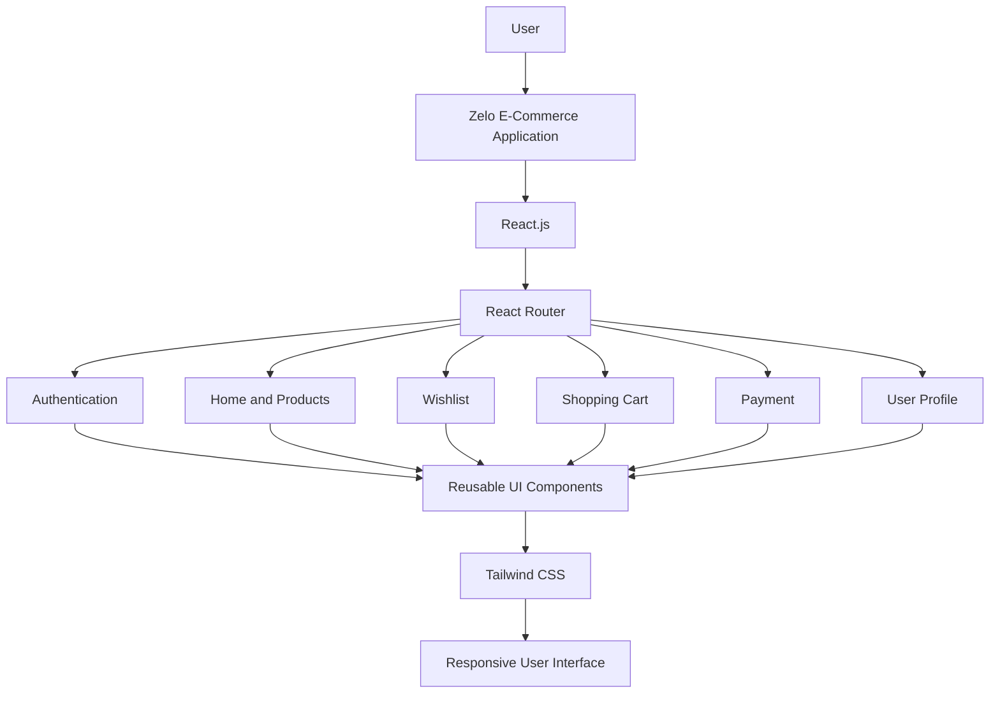

# Zelo – E-Commerce Web Application

Zelo is a modern and responsive E-Commerce web application developed using React.js. It provides users with a smooth online shopping experience, allowing them to explore products, manage wishlists, add items to their cart, and complete the shopping and payment process.

The project was developed to strengthen my frontend development skills and gain practical experience in building a real-world E-Commerce application.

## Table of Contents

* [Features](#features)
* [Technologies Used](#technologies-used)
* [Application Architecture](#application-architecture)
* [Project Screenshots](#project-screenshots)
* [How to Run the Project](#how-to-run-the-project)
* [Author](#author)

## Features

* User Registration and Login
* Forgot Password Functionality
* Browse and Explore Products
* Add and Remove Products from Wishlist
* Shopping Cart Management
* Payment Process
* User Profile Management
* Responsive Design
* Easy-to-Use Interface

## Technologies Used

| Technology   | Purpose                       |
| ------------ | ----------------------------- |
| React.js     | Frontend Development          |
| JavaScript   | Application Logic             |
| Tailwind CSS | Styling and Responsive Design |
| HTML5        | Web Structure                 |
| React Router | Navigation and Routing        |
| Vite         | Development and Build Tool    |

## Application Architecture

Zelo follows a component-based React architecture. The application is divided into different pages and UI components to make the code organized, reusable, and easier to maintain.

### Architecture Diagram



### Application Flow

1. Users access the application through the browser.
2. React.js renders the user interface using reusable components.
3. React Router manages navigation between different pages.
4. Users can browse products, manage their wishlist, and add products to the shopping cart.
5. Users can proceed through the payment process and manage their profile.

## Project Screenshots

The following screenshots showcase different pages and functionalities of the Zelo E-Commerce application.

### 1. Login Page

<p align="center">
  
</p>

### 2. Sign Up Page

<p align="center">
  
</p>

### 3. Forgot Password

<p align="center">
  
</p>

### 4. Home Page

<p align="center">
  
</p>

<p align="center">
  
</p>

<p align="center">
  
</p>

### 5. Wishlist

<p align="center">
  
</p>

### 6. Shopping Cart

<p align="center">
  
</p>

<p align="center">
  
</p>

### 7. Payment Process

<p align="center">
  
</p>

<p align="center">
  
</p>

### 8. Logout

<p align="center">
  
</p>

### 9. User Profile

<p align="center">
  
</p>

## How to Run the Project

**1. Clone the repository**

```bash
git clone https://github.com/is-pankaj05/E-Commerce-Web-Application.git
```

**2. Navigate to the project directory**

```bash
cd E-Commerce-Web-Application
```

**3. Install dependencies**

```bash
npm install
```

**4. Start the development server**

```bash
npm run dev
```

**5. Open the application**

Open the local URL displayed in your terminal to access the application in your browser.

## Author

**Pankaj Verma**

B.Tech – Electronics and Communication Engineering
MMMUT, Gorakhpur

GitHub: [is-pankaj05](https://github.com/is-pankaj05)
