E-Commerce Web Application (Zelo) : 

Zelo is an E-Commerce website that I developed to make online shopping easier. Users can explore products, create an account, manage their wishlist, and go through the shopping and payment process.
I built this project using React and other web technologies to improve my frontend development skills and understand how an E-Commerce website works.

Features :  
    User Login and Signup,  Forgot Password,  Browse Products,  Add Products to Wishlist,  Shopping Cart,  Payment Functionality,  Responsive Design,  Easy-to-Use Interface 

  
Technologies Used :   
    React.js,  JavaScript,  Tailwind CSS,  HTML,  React Router,  Vite

Screenshots : 

  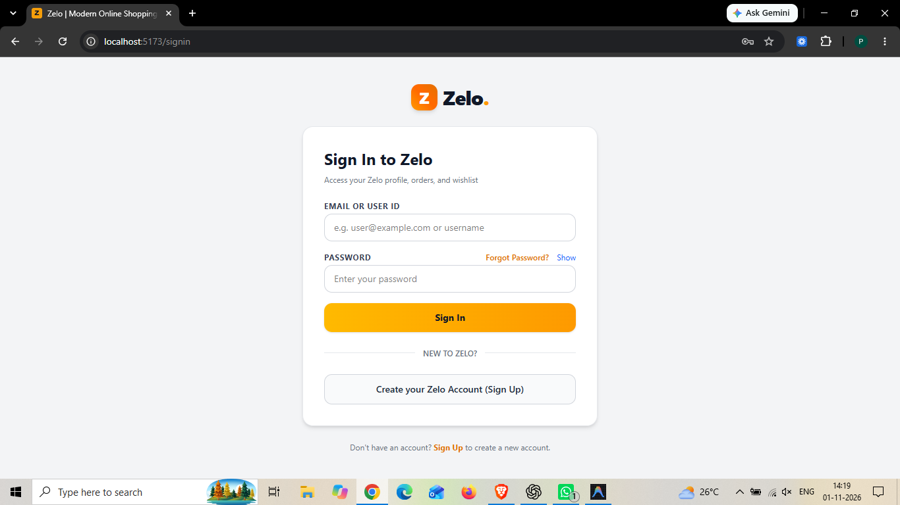  

  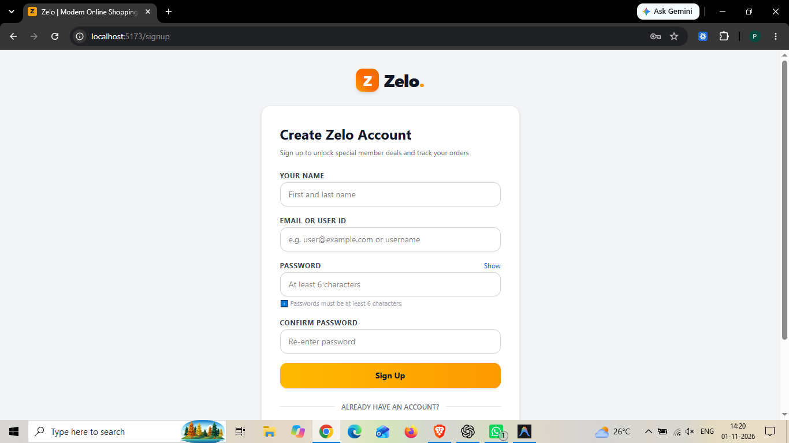  
  
  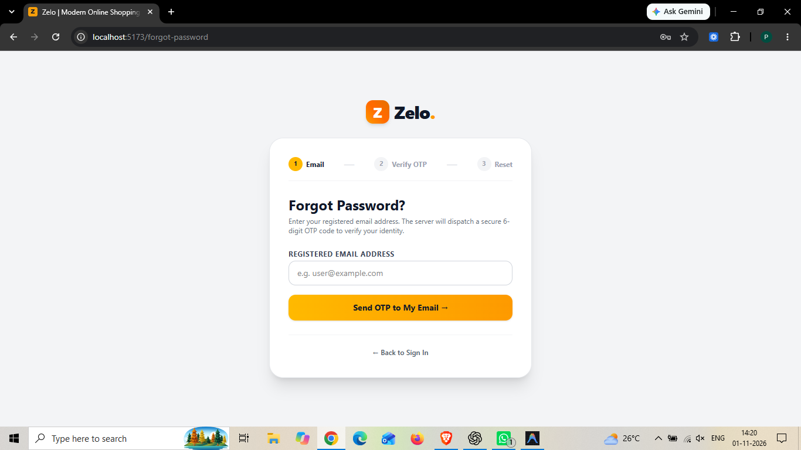  
  
  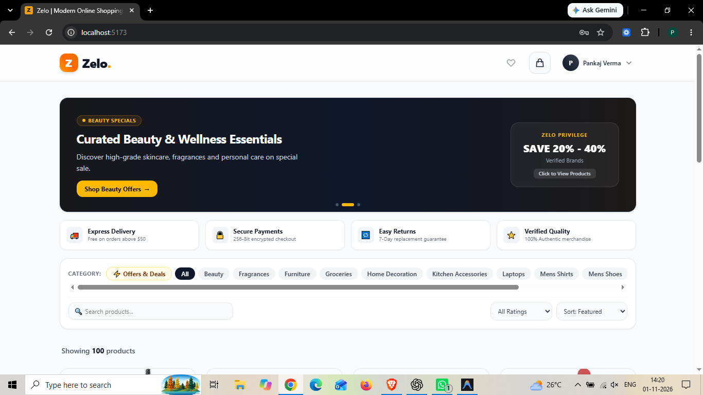  
  
  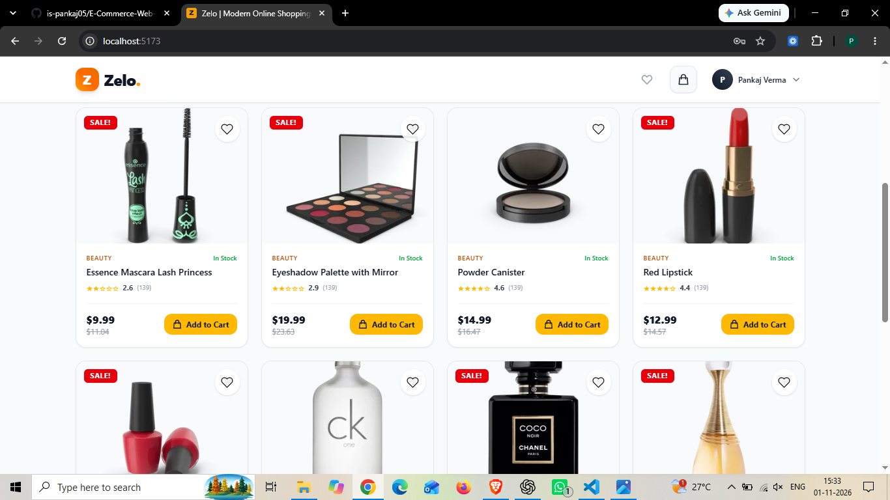  
  
  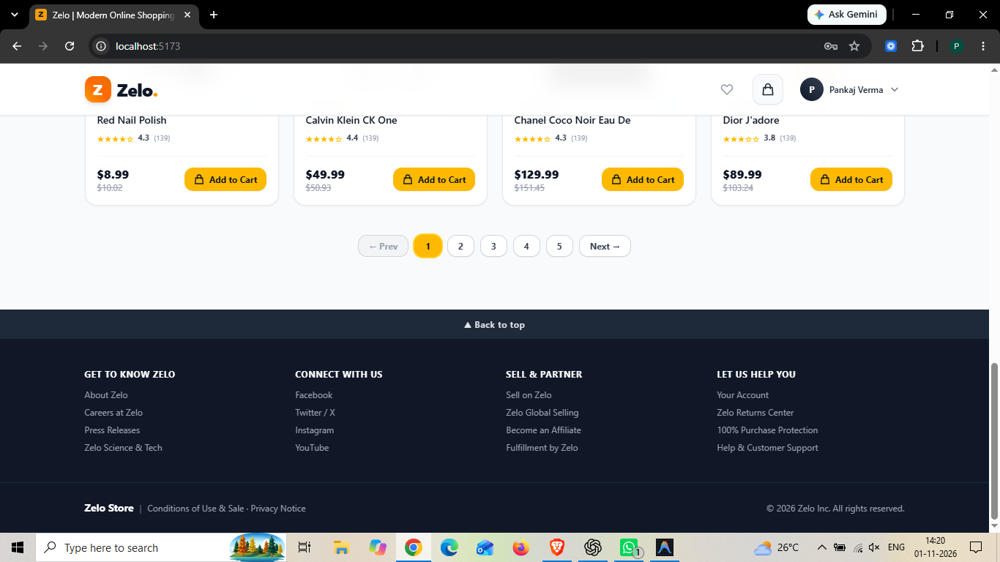  
  
  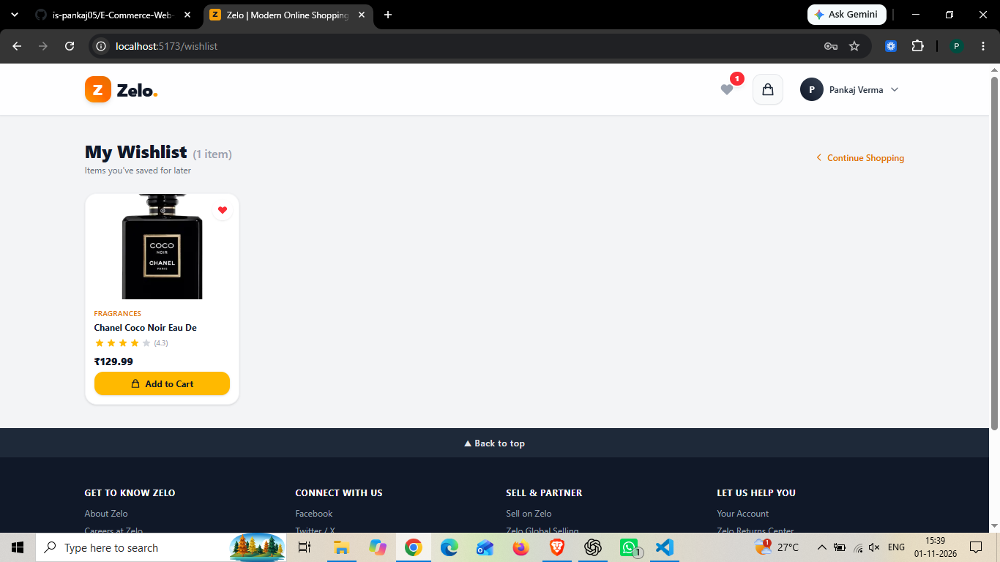  
  
  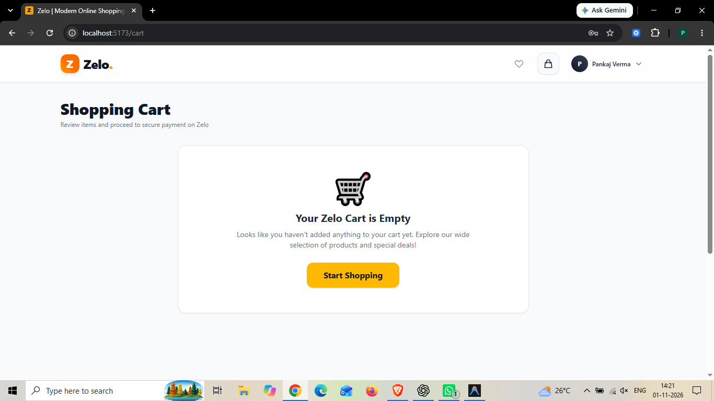  
  
  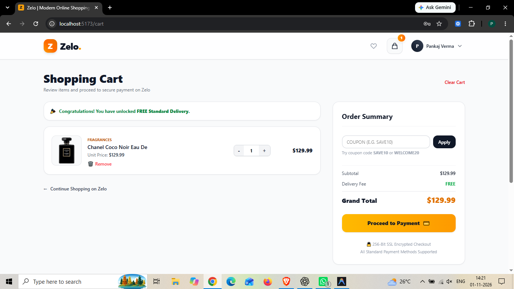  
  
  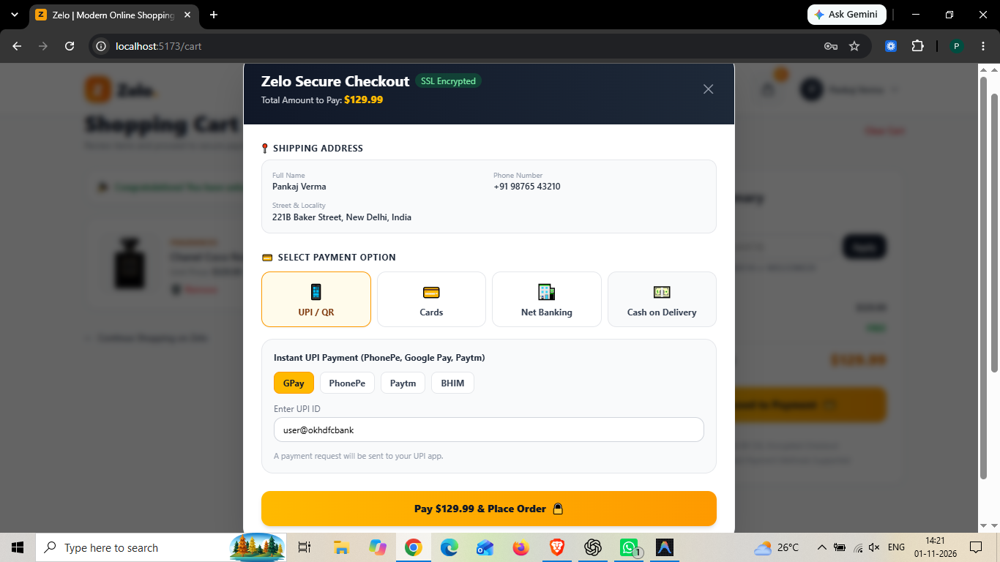  
  
  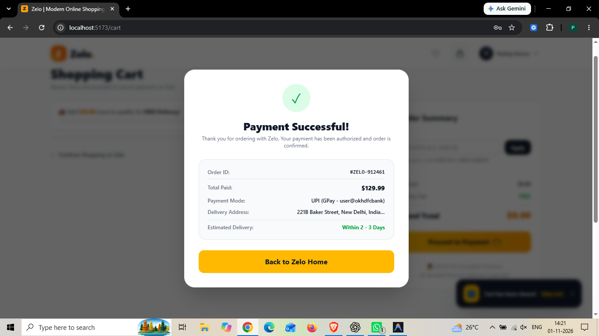  
  
  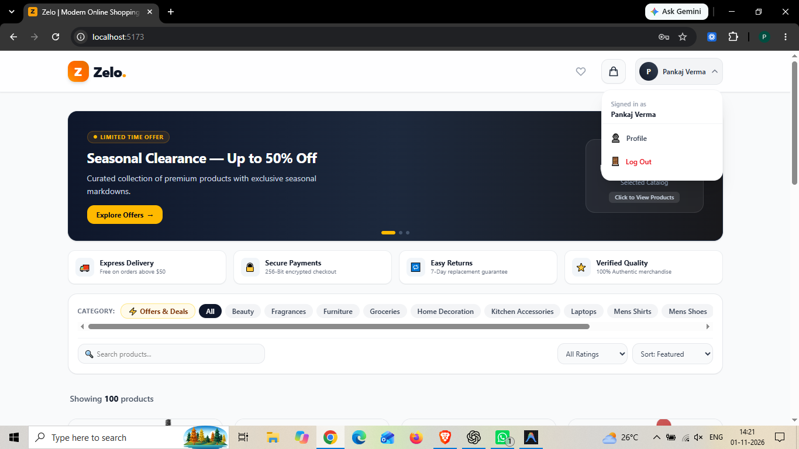  
  
  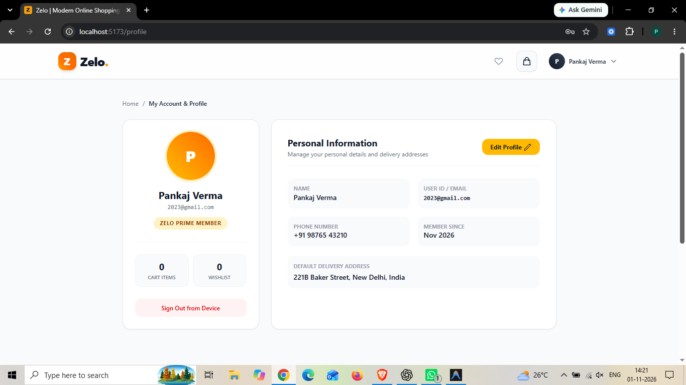  

How to Run the Project : 
  1. Clone this repository:  
      git clone https://github.com/is-pankaj05/E-Commerce-Web-Application.git
  2. Open the project folder:  
      cd E-Commerce-Web-Application
  3. Install the required packages:  
      npm install
  4. Start the project:  
      npm run dev
  5. Open the local URL shown in the terminal. 

Author : 
  Pankaj Verma,  
  B.Tech ECE || MMMUT Gorakhpur

